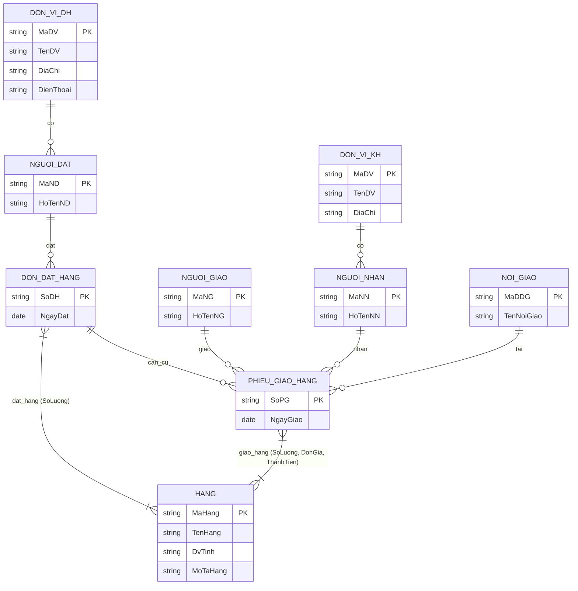
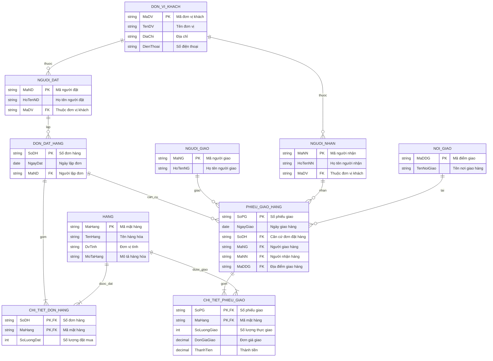

# [Thực hành] Quản lý đơn đặt hàng - Thiết kế sơ đồ ERD

## 🎯 Mục tiêu
- Phân tích và lựa chọn thông tin từ các chứng từ nghiệp vụ thực tế (Đơn đặt hàng, Phiếu giao hàng).
- Xác định các thực thể (Entities), thuộc tính (Attributes) và khóa chính (Primary Keys).
- Xác định và mô hình hóa các mối quan hệ (Relationships & Cardinalities).
- Xây dựng mô hình thực thể liên kết (ERD) ban đầu.
- Chuẩn hóa, tối ưu và rút gọn mô hình ERD để chuyển đổi sang mô hình cơ sở dữ liệu quan hệ (Relational Schema).

---

## 📋 Mô tả bài toán
Xây dựng mô hình ERD cho cơ sở dữ liệu **Quản lý đơn đặt hàng** phục vụ quy trình đặt hàng và giao hàng của doanh nghiệp với các đối tác, khách hàng.

---

## 🛠 Hướng dẫn chi tiết từng bước

### Bước 1: Liệt kê, chọn lọc thông tin từ chứng từ

Từ 2 chứng từ thực tế của quy trình bán hàng, ta thu thập được các trường thông tin sau:

#### 1. Đơn đặt hàng
- **Số đơn hàng (Số ĐH)**: Mã định danh duy nhất của đơn hàng.
- **Tên đơn vị đặt hàng (Tên ĐV)**: Tên công ty / tổ chức đặt mua.
- **Địa chỉ**: Địa chỉ của đơn vị đặt hàng.
- **Điện thoại**: Số điện thoại liên hệ của đơn vị đặt hàng.
- **Ngày đặt**: Thời điểm lập đơn đặt hàng.
- **Tên hàng**: Tên sản phẩm được đặt.
- **Mô tả**: Mô tả chi tiết hàng hóa.
- **Đơn vị tính (Đv tính)**: Đơn vị đo lường (cái, hộp, kg, thùng,...).
- **Số lượng**: Số lượng hàng hóa cần đặt.
- **Người đặt hàng (Họ tên NĐ)**: Nhân sự đại diện của đơn vị đặt hàng.

#### 2. Phiếu giao hàng
- **Số phiếu giao hàng (Số PG)**: Mã định danh duy nhất của phiếu giao.
- **Tên đơn vị đặt hàng (Tên ĐV)**: Tên đơn vị nhận hàng (khách hàng).
- **Địa chỉ**: Địa chỉ đơn vị khách hàng.
- **Nơi giao hàng (Tên nơi GH)**: Địa điểm thực tế bàn giao hàng hóa (kho, chi nhánh,...).
- **Ngày giao**: Thời điểm giao nhận hàng.
- **Tên hàng**: Hàng hóa thực tế được giao.
- **Đơn vị tính (Đv tính)**: Đơn vị tính hàng giao.
- **Số lượng**: Số lượng thực tế giao.
- **Đơn giá**: Giá bán của 1 đơn vị hàng hóa tại thời điểm giao.
- **Thành tiền**: Giá trị hàng giao (`Số lượng` × `Đơn giá`).
- **Tên người nhận (Họ tên NN)**: Người đại diện bên mua tiếp nhận hàng.
- **Tên người giao (Họ tên NG)**: Nhân viên vận chuyển / kho giao hàng.

---

### Bước 2: Xác định thực thể và thuộc tính

Từ thông tin đã chọn lọc, ta gom nhóm thành các thực thể độc lập cùng các thuộc tính tương ứng:

| STT | Thực thể | Thuộc tính | Khóa chính (PK) |
|---|---|---|---|
| 1 | **ĐƠN VỊ ĐH** | Mã ĐV, Tên ĐV, Địa chỉ, Điện thoại | `Mã ĐV` |
| 2 | **ĐƠN VỊ KH** | Mã ĐV, Tên ĐV, Địa chỉ | `Mã ĐV` |
| 3 | **HÀNG** | Mã hàng, Tên hàng, Đv tính, Mô tả hàng | `Mã hàng` |
| 4 | **NGƯỜI ĐẶT** | Mã số NĐ, Họ tên NĐ | `Mã số NĐ` |
| 5 | **NƠI GIAO** | Mã số ĐĐG, Tên nơi giao | `Mã số ĐĐG` |
| 6 | **NGƯỜI NHẬN** | Mã số NN, Họ tên NN | `Mã số NN` |
| 7 | **NGƯỜI GIAO** | Mã số NG, Họ tên NG | `Mã số NG` |
| 8 | **ĐƠN ĐẶT HÀNG** | Số ĐH, Ngày đặt | `Số ĐH` |
| 9 | **PHIẾU GIAO HÀNG** | Số PG, Ngày giao | `Số PG` |

---

### Bước 3: Xác định các mối quan hệ (Relationships)

Dựa trên hai động từ cốt lõi trong quy trình: **ĐẶT** và **GIAO**, ta phân tích các mối liên kết:

1. **Người đặt hàng & Đơn vị đặt hàng**:
   - Một Đơn vị đặt hàng có thể có một hoặc nhiều Người đặt hàng (`1 - N`).
   - Mỗi Người đặt hàng thuộc về duy nhất một Đơn vị đặt hàng (`N - 1`).
   - ➡️ **Quan hệ:** `NGƯỜI ĐẶT` **THUỘC** `ĐƠN VỊ ĐH`.

2. **Người nhận hàng & Đơn vị khách hàng**:
   - Một Đơn vị khách hàng có thể có một hoặc nhiều Người nhận hàng (`1 - N`).
   - Mỗi Người nhận hàng thuộc về duy nhất một Đơn vị khách hàng (`N - 1`).
   - ➡️ **Quan hệ:** `NGƯỜI NHẬN` **THUỘC** `ĐƠN VỊ KH`.

3. **Người đặt hàng & Đơn đặt hàng**:
   - Một Người đặt có thể lập nhiều Đơn đặt hàng theo thời gian (`1 - N`).
   - Mỗi Đơn đặt hàng do một Người đặt đại diện lập (`N - 1`).
   - ➡️ **Quan hệ:** `NGƯỜI ĐẶT` **ĐẶT / LẬP** `ĐƠN ĐẶT HÀNG`.

4. **Đơn đặt hàng & Hàng hóa**:
   - Một Đơn đặt hàng có thể đặt nhiều mặt hàng khác nhau.
   - Một mặt hàng có thể xuất hiện trong nhiều Đơn đặt hàng khác nhau.
   - ➡️ **Quan hệ nhiều - nhiều (`N - N`):** `ĐƠN ĐẶT HÀNG` **GỒM** `HÀNG`.
   - *Thuộc tính quan hệ:* `Số lượng đặt`.

5. **Người giao & Phiếu giao hàng**:
   - Một nhân viên giao hàng có thể giao nhiều Phiếu giao hàng (`1 - N`).
   - Mỗi Phiếu giao do một nhân viên giao hàng phụ trách (`N - 1`).
   - ➡️ **Quan hệ:** `NGƯỜI GIAO` **GIAO** `PHIẾU GIAO HÀNG`.

6. **Người nhận & Phiếu giao hàng**:
   - Một Người nhận có thể tiếp nhận nhiều Phiếu giao hàng (`1 - N`).
   - Mỗi Phiếu giao hàng do một Người nhận ký nhận (`N - 1`).
   - ➡️ **Quan hệ:** `NGƯỜI NHẬN` **NHẬN** `PHIẾU GIAO HÀNG`.

7. **Nơi giao & Phiếu giao hàng**:
   - Một địa điểm giao hàng có thể được giao nhiều lần qua nhiều Phiếu giao (`1 - N`).
   - Mỗi Phiếu giao chuyển hàng tới một Nơi giao xác định (`N - 1`).
   - ➡️ **Quan hệ:** `PHIẾU GIAO HÀNG` **TẠI** `NƠI GIAO`.

8. **Phiếu giao hàng & Hàng hóa**:
   - Một Phiếu giao hàng có thể giao nhiều mặt hàng.
   - Một mặt hàng có thể được giao trong nhiều Phiếu giao hàng khác nhau.
   - ➡️ **Quan hệ nhiều - nhiều (`N - N`):** `PHIẾU GIAO HÀNG` **GỒM** `HÀNG`.
   - *Thuộc tính quan hệ:* `Số lượng giao`, `Đơn giá giao`, `Thành tiền`.

9. **Đơn đặt hàng & Phiếu giao hàng**:
   - Một Đơn đặt hàng có thể được giao qua một hoặc nhiều Phiếu giao hàng (giao từng đợt) (`1 - N`).
   - Mỗi Phiếu giao hàng được lập căn cứ theo một Đơn đặt hàng cụ thể (`N - 1`).
   - ➡️ **Quan hệ:** `ĐƠN ĐẶT HÀNG` **CĂN CỨ CHO** `PHIẾU GIAO HÀNG`.

---

### Bước 4: Biểu đồ mô hình thực thể ERD ban đầu

Biểu đồ mô hình ERD trước khi tối ưu:



---

### Bước 5: Chuẩn hóa, rút gọn mô hình thực thể ERD

#### 1. Lý do chuẩn hóa & rút gọn:
- **Gộp thực thể trùng lặp ngữ nghĩa**: `ĐƠN VỊ ĐẶT HÀNG` và `ĐƠN VỊ KHÁCH HÀNG` đều là đối tác/khách hàng bên ngoài giao dịch với doanh nghiệp, có tập thuộc tính tương đương. Do đó ta gộp chung thành một thực thể duy nhất: **`ĐƠN VỊ KHÁCH`** (`Mã ĐV`, `Tên ĐV`, `Địa chỉ`, `Điện thoại`).
- Cả `NGƯỜI ĐẶT` và `NGƯỜI NHẬN` đều là nhân sự thuộc `ĐƠN VỊ KHÁCH`.
- **Triệt tiêu quan hệ nhiều - nhiều (`N - N`)**:
  - Tách quan hệ giữa `ĐƠN ĐẶT HÀNG` và `HÀNG` thành thực thể liên kết: **`CHI TIẾT ĐƠN HÀNG`** (`Số ĐH`, `Mã hàng`, `Số lượng đặt`).
  - Tách quan hệ giữa `PHIẾU GIAO HÀNG` và `HÀNG` thành thực thể liên kết: **`CHI TIẾT PHIẾU GIAO`** (`Số PG`, `Mã hàng`, `Số lượng giao`, `Đơn giá giao`, `Thành tiền`).

#### 2. Biểu đồ mô hình ERD sau chuẩn hóa (Hoàn thiện):



---

## 🗄 Mô hình cơ sở dữ liệu quan hệ (Relational Schema)

1. `DON_VI_KHACH` (**MaDV**, TenDV, DiaChi, DienThoai)
2. `NGUOI_DAT` (**MaND**, HoTenND, *MaDV*)
3. `NGUOI_NHAN` (**MaNN**, HoTenNN, *MaDV*)
4. `NGUOI_GIAO` (**MaNG**, HoTenNG)
5. `NOI_GIAO` (**MaDDG**, TenNoiGiao)
6. `HANG` (**MaHang**, TenHang, DvTinh, MoTaHang)
7. `DON_DAT_HANG` (**SoDH**, NgayDat, *MaND*)
8. `CHI_TIET_DON_HANG` (**SoDH**, **MaHang**, SoLuongDat)
9. `PHIEU_GIAO_HANG` (**SoPG**, NgayGiao, *SoDH*, *MaNG*, *MaNN*, *MaDDG*)
10. `CHI_TIET_PHIEU_GIAO` (**SoPG**, **MaHang**, SoLuongGiao, DonGiaGiao, ThanhTien)

---

## 💻 Cấu trúc thư mục dự án

```text
erd-rder-anagement/
├── README.md        # Báo cáo chi tiết thiết kế ERD từ Bước 1 đến Bước 5
├── database.sql     # Script DDL MySQL tạo bảng, khóa chính/ngoại & dữ liệu mẫu
└── index.html       # Ứng dụng xem trực quan mô hình ERD tương tác
```

---

## 🚀 Hướng dẫn chạy và kiểm thử SQL

1. Mở MySQL Workbench hoặc phpMyAdmin / HeidiSQL / DBeaver / terminal:
   ```bash
   mysql -u root -p < database.sql
   ```
2. Mở file [index.html](file:///C:/Users/ductr/.gemini/antigravity-ide/scratch/erd-rder-anagement/index.html) trực tiếp trên trình duyệt để tương tác trực quan với sơ đồ ERD.
